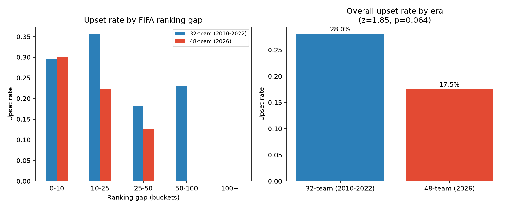

# The 48-Team Effect: Predicting World Cup Upsets

A statistical look at whether FIFA pre-tournament rankings predict match upsets, and whether the 2026 expansion to 48 teams changed the upset rate compared to the 32-team era (2010–2022).

Built for a Sports Analytics Group at Berkeley (SAGB) conference application.

## Key Findings

- FIFA ranking gap negatively predicts upsets, as expected (logistic regression coefficient: -0.029)
- Knockout-stage matches see fewer upsets than group-stage matches (-0.51)
- The 48-team 2026 era had a **lower** upset rate (17.5%) than the 32-team era (28.0%) — counterintuitive
- Two-proportion z-test on the era difference: z = 1.85, p = 0.064 (suggestive, not statistically significant)

## Data Sources

- [martj42/international_results](https://github.com/martj42/international_results) — historical match results and penalty shootouts
- [Dato-Futbol/fifa-ranking](https://github.com/Dato-Futbol/fifa-ranking) — historical FIFA ranking snapshots
- [mominullptr/FIFA-World-Cup-2026-Dataset](https://github.com/mominullptr/FIFA-World-Cup-2026-Dataset) — 2026 World Cup match data with rankings included

## Pipeline

1. `build_dataset.py` — filters 2010–2022 World Cup matches, determines Group vs. Knockout stage, attaches FIFA rankings and penalty shootout results, flags upsets
2. `build_2026.py` — processes the 2026 dataset into the same format and merges both eras
3. `model.py` — runs a two-proportion z-test comparing upset rates across eras, fits a logistic regression, and produces `upset_analysis.png`

## Running It

```bash
python3 -m venv venv
source venv/bin/activate
pip install pandas numpy scikit-learn statsmodels matplotlib
python3 build_dataset.py
python3 build_2026.py
python3 model.py
```

## Result


